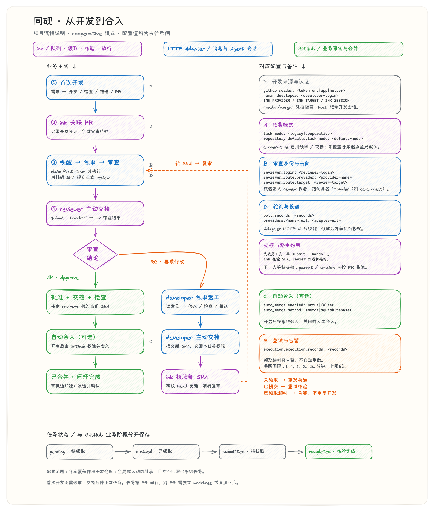

# Ink Commons

English | [简体中文](README.zh-CN.md)

**Ink Commons** (`ink`) is a single-host, pure-Go GitHub pull-request orchestrator for human and AI-agent review workflows. It turns GitHub PR snapshots into durable review, rework, notification, and optional auto-merge state—while staying protocol-neutral toward execution runtimes.

- **GitHub PR snapshot as business truth**: Only formal GitHub reviews for the exact `head.sha` and new pushed commits advance workflow `phase`; adapter acceptance or execution success never fakes completion.
- **Protocol-neutral HTTP adapters**: Connect any agent runtime through [Adapter HTTP v1](docs/adapter-http-v1.md) and named `providers` (including a standalone `cc-connect` adapter in `cmd/ink-adapter-ccconnect` and a zero-dependency demo in `examples/http-executor/`).
- **Safe by default**: Persist intent before external side effects (`deliver`, `notify`, `post_approval`, `auto_merge`), isolate `github_reader` and `github_merger` credentials with no implicit fallback to personal `gh` logins, and keep local control on a `0600` Unix socket.
- **Zero-CGO single binary**: Pure Go (`CGO_ENABLED=0`) backed by SQLite schema v7 (`modernc.org/sqlite`) with bounded per-PR concurrency and Full/Lite Git worktree pools.

## Core Workflow

The diagram below shows the cooperative PR review, rework, handoff verification, and optional auto-merge flow:



[Full-size diagram](docs/diagrams/cooperative-workflow.png) · [Editable Excalidraw source](docs/diagrams/cooperative-workflow.excalidraw) · [Architecture & Dual-Layer State Machine](docs/architecture.md)

## 5-Minute Quickstart

### Prerequisites & Supported Platforms

- **Supported platforms**: **Linux** and **macOS** (`amd64` / `arm64`). Windows is not supported (POSIX build constraints exclude Windows).
- **Build prerequisites**: Go 1.23+ and Git.

### 1. Build from Source

```sh
git clone https://github.com/wujinhjun/ink-commons.git
cd ink-commons
make build
```

This builds `bin/ink` (the core daemon & CLI) and `bin/ink-adapter-ccconnect` (the optional standalone `cc-connect` adapter).

### 2. Verify End-to-End Without GitHub Credentials

Run the standalone minimal HTTP executor test (`examples/http-executor/`), which boots an isolated `ink` daemon with a fake GitHub reader, links a PR over the real Unix socket, and exercises `prepare` and `deliver` over loopback HTTP:

```sh
go test -v ./examples/http-executor
```

### 3. Run the Minimal HTTP Executor + Daemon Locally

Start the minimal HTTP executor in one terminal (listens on `http://127.0.0.1:8789/v1/execute`):

```sh
go run ./examples/http-executor
```

In a second terminal, initialize a fresh `0700` state directory, start `ink serve` with the demo provider, and verify daemon health:

```sh
export INK_DEMO_ROOT="$(mktemp -d /tmp/ink-demo-XXXXXX)"
export INK_DATA_DIR="$INK_DEMO_ROOT/state"

cat > "$INK_DEMO_ROOT/config.json" <<'EOF'
{
  "poll_seconds": 60,
  "providers": {
    "local-demo": {
      "url": "http://127.0.0.1:8789/v1/execute",
      "capabilities": ["prepare", "deliver"]
    }
  }
}
EOF

./bin/ink state init --data "$INK_DATA_DIR"
./bin/ink serve --config "$INK_DEMO_ROOT/config.json" --data "$INK_DATA_DIR"
```

In a third terminal, check daemon health and local API access (use the same `INK_DEMO_ROOT` and `INK_DATA_DIR`):

```sh
./bin/ink doctor --config "$INK_DEMO_ROOT/config.json" --data "$INK_DATA_DIR" --json
./bin/ink work list --data "$INK_DATA_DIR" --json
```

Next, copy [`config.example.json`](config.example.json) (validated by [`config.schema.json`](config.schema.json)), configure `github_reader` (and optionally `github_merger`), register a repository with `ink repo add owner/repo`, and install agent workflow skills with `ink init && ink init --check`.

## Documentation

| Topic | Document |
| --- | --- |
| Documentation index | [`docs/README.md`](docs/README.md) |
| Architecture & dual-layer state machine | [`docs/architecture.md`](docs/architecture.md) |
| CLI command reference (`--data`, `--json`) | [`docs/cli.md`](docs/cli.md) |
| Centralized configuration & policy scopes | [`docs/configuration.md`](docs/configuration.md) · [`config.example.json`](config.example.json) · [`config.schema.json`](config.schema.json) |
| HTTP adapters & `ink-adapter-ccconnect` | [`docs/adapters.md`](docs/adapters.md) · [`docs/adapter-http-v1.md`](docs/adapter-http-v1.md) · [`examples/http-executor/`](examples/http-executor/README.md) |
| GitHub credentials, ETag caching & merge strategy | [`docs/github-contracts.md`](docs/github-contracts.md) |
| Cooperative claim & business handoff | [`docs/handoff.md`](docs/handoff.md) |
| Execution lifecycle & managed executors | [`docs/execution.md`](docs/execution.md) |
| Linux `systemd` & macOS `launchd` deployment | [`docs/deployment.md`](docs/deployment.md) · [`deploy/README.md`](deploy/README.md) |
| Single-instance cutover & schema upgrades | [`docs/migration.md`](docs/migration.md) |

## Security, Contributing & License

- **Security**: Review trust boundaries and vulnerability reporting in [`SECURITY.md`](SECURITY.md).
- **Contributing**: See [`CONTRIBUTING.md`](CONTRIBUTING.md), [`CHANGELOG.md`](CHANGELOG.md), and [`TODO.md`](TODO.md).
- **License**: Released under the [MIT License](LICENSE).
