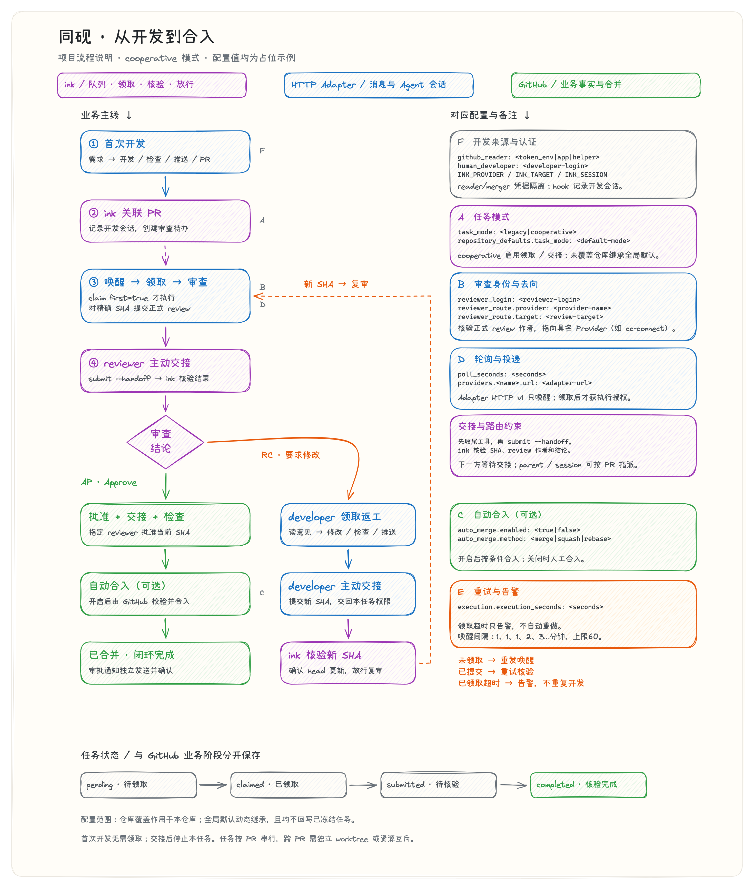

# Ink Commons 同砚

[English](README.md) | 简体中文

**Ink Commons（同砚 / `ink`）** 是一个单机、纯 Go 实现的 GitHub Pull Request 协同编排器，服务于人与 AI Agent 共同参与的 PR 开发与审查闭环。它以 GitHub PR 快照为业务真值，持久化审查、返工、通知与可选自动合入状态，同时对执行端协议保持中立。

- **GitHub PR 快照即业务真值**：只有指定 reviewer 对当前 `head.sha` 提交的正式 GitHub review 或新推送的 commit 才会推进业务 `phase`；执行端返回 `accepted` 或运行结束本身不代表业务完成。
- **协议中立的 HTTP Adapter**：通过 [Adapter HTTP v1](docs/adapter-http-v1.md) 与具名 `providers` 接入任意 Agent 运行时（仓库内置独立入口 `cmd/ink-adapter-ccconnect` 与零外部依赖最小示例 `examples/http-executor/`）。
- **默认安全克制**：外部副作用前先持久化（`deliver`、`notify`、`post_approval`、`auto_merge`）；`github_reader` 与 `github_merger` 凭据按角色隔离，严禁隐式回退个人 `gh` 登录；本地控制面限定在 `0600` 私有 Unix socket。
- **纯 Go 单二进制**：`CGO_ENABLED=0` 零 CGO 编译，内置 SQLite schema v7（`modernc.org/sqlite`），支持跨 PR 有界并发、单 PR 严格串行及 Full/Lite Git 工作区池。

## 核心工作流

下图展示 cooperative 模式下的任务领取、审查、返工交接核验与可选自动合入闭环：



[查看原图](docs/diagrams/cooperative-workflow.png) · [Excalidraw 可编辑源文件](docs/diagrams/cooperative-workflow.excalidraw) · [系统架构与双层状态机](docs/architecture.md)

## 5 分钟快速上手

### 支持平台与前置要求

- **支持平台**：**Linux** 与 **macOS**（`amd64` / `arm64`）。不支持 Windows（POSIX build tags 明确排除 Windows）。
- **构建依赖**：Go 1.23+ 与 Git。

### 1. 从源码构建

```sh
git clone https://github.com/wujinhjun/ink-commons.git
cd ink-commons
make build
```

构建产物位于 `bin/ink`（核心 daemon 与 CLI）和 `bin/ink-adapter-ccconnect`（可选独立 `cc-connect` Adapter）。

### 2. 无需 GitHub 凭据的端到端验证

运行 `examples/http-executor/` 内置测试，它会自动拉起隔离的 `ink` daemon 与模拟 GitHub reader，经真实 Unix socket 关联 PR，并在 loopback HTTP 上走通 `prepare` 与 `deliver`：

```sh
go test -v ./examples/http-executor
```

### 3. 本地启动最小 HTTP Executor 与 Daemon

在第一个终端启动最小 HTTP Executor（监听 `http://127.0.0.1:8789/v1/execute`）：

```sh
go run ./examples/http-executor
```

在第二个终端初始化全新 `0700` 状态目录、写入 Demo 配置并启动 `ink serve`：

```sh
export INK_DEMO_ROOT="$(mktemp -d /tmp/ink-demo-XXXXXX)"
export INK_DATA_DIR="$INK_DEMO_ROOT/state"

cat > "$INK_DEMO_ROOT/config.json" <<'EOF'
{
  "poll_seconds": 60,
  "providers": {
    "local-demo": {
      "url": "http://127.0.0.1:8789/v1/execute",
      "capabilities": ["prepare", "deliver"]
    }
  }
}
EOF

./bin/ink state init --data "$INK_DATA_DIR"
./bin/ink serve --config "$INK_DEMO_ROOT/config.json" --data "$INK_DATA_DIR"
```

在第三个终端验证 daemon 健康状态与本地 API（保持相同的 `INK_DEMO_ROOT` 与 `INK_DATA_DIR`）：

```sh
./bin/ink doctor --config "$INK_DEMO_ROOT/config.json" --data "$INK_DATA_DIR" --json
./bin/ink work list --data "$INK_DATA_DIR" --json
```

下一步：参考 [`config.example.json`](config.example.json)（附 [`config.schema.json`](config.schema.json) 校验）配置 `github_reader`（及可选 `github_merger`），通过 `ink repo add owner/repo` 注册仓库，并运行 `ink init && ink init --check` 安装 Agent 协作技能。

## 文档导航

| 主题 | 文档 |
| --- | --- |
| 文档总索引 | [`docs/README.md`](docs/README.md) |
| 系统架构与双层状态机 | [`docs/architecture.md`](docs/architecture.md) |
| CLI 命令参考（`--data`、`--json`） | [`docs/cli.md`](docs/cli.md) |
| 中心化配置与策略作用域 | [`docs/configuration.md`](docs/configuration.md) · [`config.example.json`](config.example.json) · [`config.schema.json`](config.schema.json) |
| HTTP Adapter 与 `ink-adapter-ccconnect` | [`docs/adapters.md`](docs/adapters.md) · [`docs/adapter-http-v1.md`](docs/adapter-http-v1.md) · [`examples/http-executor/`](examples/http-executor/README.md) |
| GitHub 凭据隔离、ETag 缓存与合入策略 | [`docs/github-contracts.md`](docs/github-contracts.md) |
| 主动领取与业务交接（cooperative） | [`docs/handoff.md`](docs/handoff.md) |
| 执行生命周期与受管执行端 | [`docs/execution.md`](docs/execution.md) |
| Linux `systemd` 与 macOS `launchd` 部署指南 | [`docs/deployment.md`](docs/deployment.md) · [`deploy/README.md`](deploy/README.md) |
| 单实例切换与 Schema 升级检查清单 | [`docs/migration.md`](docs/migration.md) |

## 安全、贡献与开源协议

- **安全策略**：信任边界与漏洞报告方式见 [`SECURITY.md`](SECURITY.md)。
- **参与贡献**：参见 [`CONTRIBUTING.md`](CONTRIBUTING.md)、[`CHANGELOG.md`](CHANGELOG.md) 与 [`TODO.md`](TODO.md)。
- **开源协议**：采用 [MIT License](LICENSE)。
