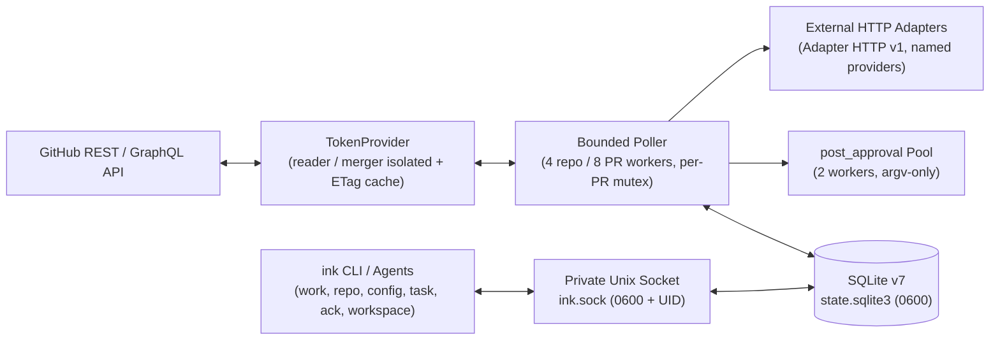
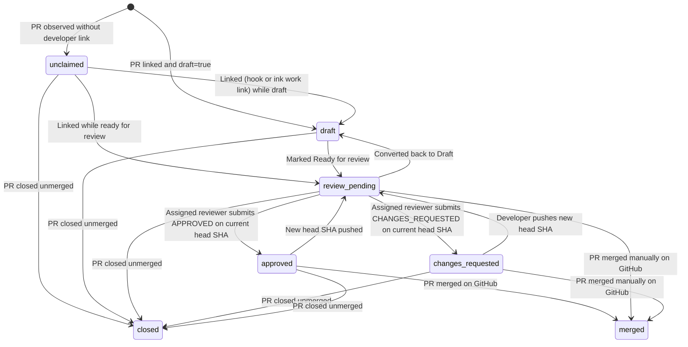
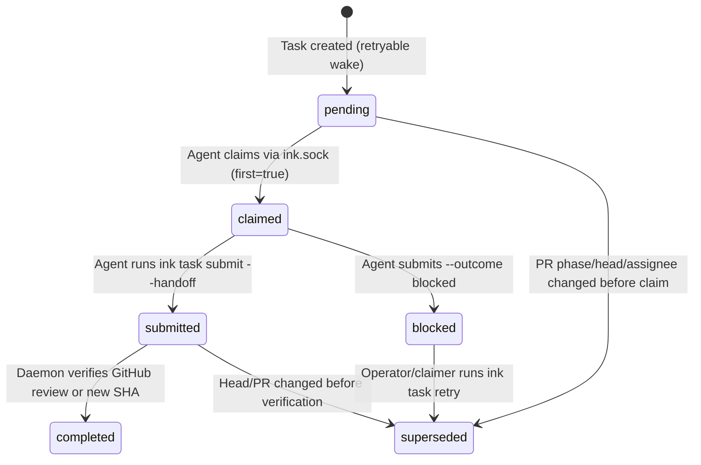
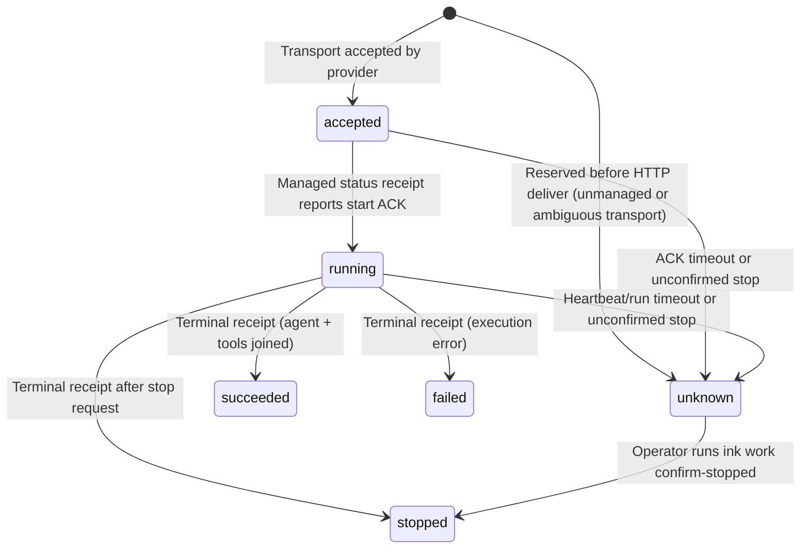

# Architecture

Ink Commons is a single-host, pure-Go GitHub pull-request orchestrator for Linux and macOS. It separates **GitHub business truth** from **execution transport**, persists intent before external side effects, and enforces explicit trust boundaries between local operators/agents and external HTTP adapters.

## System Components

| Component | Package / Entry Point | Responsibility |
| --- | --- | --- |
| Core CLI & daemon | `cmd/ink/` | Cobra CLI, static config loader (`config.schema.json`), provider admission, daemon startup. Zero dependency on `ccconnect`. |
| Orchestration core | `internal/ink/` | Bounded GitHub polling, dual-layer state derivation, cooperative handoff, notification ACK, SHA-locked auto-merge, workspace pool, local Unix socket API, SQLite v7 store. |
| Execution boundary | `internal/execution/` | Protocol-neutral `Executor` and optional capability interfaces (`PlacementResolver`, `ConversationAllocator`, `TaskWaker`, `Notifier`, `TaskBlockedNotifier`, `ConversationReader`, `Monitor`). |
| HTTP adapter client | `internal/execution/httpagent/` | Adapter HTTP v1 client (1 MiB limits, no redirects, `DisallowUnknownFields`, startup admission GET for `managed: true`). |
| Internal executor ledger | `internal/execution/ledger/` | SQLite admission/ownership ledger for durable executors (internal to the module in v0.1). |
| Standalone cc-connect adapter | `cmd/ink-adapter-ccconnect/`, `internal/execution/ccconnect/` | Out-of-process HTTP adapter bridging cc-connect webhooks and Discord thread placement/context. |
| Git workspace helper | `internal/workspace/` | Local Git worktree inspection and Full/Lite slot management against mounted local clones. |

## Dual-Layer State Machine

Ink Commons strictly separates **business state** (derived solely from GitHub PR snapshots) from **execution state** (local delivery attempts, cooperative handoffs, and operational diagnostics). An adapter returning `accepted`—or even a managed run finishing `succeeded`—never advances business `phase`.

### 1. Business Truth Layer (`work.phase`)

Derived deterministically in `Work.derive()` from the latest GitHub PR snapshot and formal reviews submitted by the assigned `reviewer_login` for the exact `head.sha`:

### 2. Execution & Orchestration Layer

Each active `review_pending`, `changes_requested`, or post-approval conflict-diagnosis step creates a durable `task_id`. Depending on `task_mode`, execution progresses through either **cooperative handoffs** (`task.handoff.state`) or **direct/managed attempts** (`task.runs[].state`).

#### Cooperative Handoff (`task.handoff.state`, `task_mode: "cooperative"`)

#### Direct / Managed Attempts (`attempt.state`, `task_mode: "legacy"`)

Terminal attempt states are `succeeded`, `failed`, and `stopped`. Any non-terminal attempt (`accepted`, `running`, `unknown`) or active cooperative handoff (`claimed`, `submitted`, `blocked`) blocks subsequent bot deliveries for that PR, even across SHA changes, reassignments, Draft transitions, or close/reopen cycles.

#### Derived Operational View (`workflow.state`)

`Work.refreshWorkflow()` computes `workflow.state` from `phase`, active attempts, cooperative handoffs, auto-merge state, and active `alerts`:

| `workflow.state` | Meaning |
| --- | --- |
| `unclaimed`, `draft`, `approved`, `merged`, `closed` | Mirrors `phase` when no active task or alert overrides it. |
| `waiting_human` | Task is assigned to a human (no execution route). |
| `waiting_agent` | Legacy bot task is pending delivery. |
| `waiting_start` | Delivery was `accepted`; awaiting verified `running` start ACK (or unmanaged transport confirmation). |
| `executing` | Managed attempt has a verified `running` receipt. |
| `execution_unknown` | Latest attempt is `unknown` and requires operator reconciliation. |
| `waiting_review_result` / `waiting_new_sha` | Managed attempt `succeeded`; waiting for GitHub formal review or new commit SHA. |
| `waiting_previous_execution` | New task is held while an older attempt on the same PR is non-terminal. |
| `waiting_claim` | Cooperative task is `pending` and waiting for the assigned agent to run `ink task claim`. |
| `waiting_previous_handoff` | Cooperative task is held while an earlier handoff on the PR is still `claimed`, `submitted`, or `blocked`. |
| `waiting_handoff` | Cooperative task is `claimed` (or PR is `approved` awaiting verified reviewer handoff before merge). |
| `verifying_handoff` | Cooperative handoff is `submitted`; daemon is verifying GitHub state. |
| `waiting_auto_merge` | PR is `approved` and auto-merge is waiting on checks, mergeability, or an async Stack merge request. |
| `needs_attention` | One or more active `alerts` exist (identity/SHA mismatch, unresolved execution/notification, overdue/blocked handoff, unknown merge, exhausted retries, invalid preparation). |

## Bounded Concurrency & Per-PR Serialization

Polling in `internal/ink/poll.go` decouples repository discovery, PR synchronization, and slow approval hooks while keeping every individual PR strictly serialized:

- **Repository discovery pool (`repoPollWorkers = 4`)**: Lists open PRs (with scoped `ETag` / `If-None-Match` conditional GET caching) and queries SQLite pending indexes for closed/reconciling PRs.
- **PR worker pool (`prPollWorkers = 8`)**: Syncs up to 8 distinct PRs concurrently. Each worker acquires an in-memory per-PR lock (`pullLocks` keyed by `(repo, pr_number)`) before running recovery (`blocked_notice`, `handoff`, `execution`), fresh GitHub observation, and side effects (`notifyApproved`, `autoMerge`, `notifyMerged`, `dispatch`).
- **Dedicated `post_approval` hook pool (`approvalWorkers = 2`)**: Approval hooks run asynchronously after the merge decision on a separate 2-worker pool with bounded timeouts (default 60s, max 3600s). The hook worker inherits the PR's `pullLocks` reservation and re-verifies PR head, approval, and policy before execution.
- **Single-PR generation guard**: Before committing an observation or side effect, the daemon re-checks the PR's `Version` and head SHA under the service lock so concurrent local API writes never get overwritten by stale GitHub samples.

## Persistence (SQLite v7)

- **Single source of truth**: `internal/ink/sql/schema.sql` is embedded at compile time (`//go:embed`) and drives both runtime table creation and `sqlc` generated queries (`internal/ink/statedb`).
- **Anti-empty-database guardrail**: `ink serve` opens `state.sqlite3` with `mode=rw` and verifies `PRAGMA user_version = 7` plus required tables (`work_items`, `work_tasks`, `work_notifications`, `pushes`, `runtime_config`, `workspace_allocations`). Missing or wrong-version databases fail fast instead of silently recreating an empty database and re-triggering historical tasks. Fresh directories require explicit `ink state init`; schema v6 databases upgrade atomically to v7 under `state.json.lock` (`flock`).
- **Per-PR transactional updates**: Each PR work item (`work_items`) and its indexed lookup tables (`work_tasks`, `work_notifications`) update in one SQLite transaction with optimistic `revision` checks and partial indexes for pending recovery/polling work. `runtime_config` and `pushes` use independent tables and queries.
- **Consistent offline backups**: `ink state backup` acquires `state.json.lock` (requiring `ink serve` to be stopped) and runs `VACUUM INTO` to produce an atomic `0600` SQLite snapshot.

## Trust Boundaries

1. **Private Local Control Plane (`ink.sock`)**:
   - State directory is `0700`; `ink.sock`, `state.sqlite3`, `state.json.lock`, and cooperative claim credentials (`claims/<task_id>.json`) are `0600` owned by the service UID.
   - Operators and local agents use `ink` CLI over `ink.sock` for configuration, repository lifecycle, cooperative `claim`/`submit`/`retry`, notification `ack`/`status`, review `context`, and `workspace` management.
2. **Out-of-Process Adapter Boundary (Adapter HTTP v1)**:
   - Adapters receive task/notification envelopes over loopback HTTP or remote HTTPS + Bearer token (`token_env`), with redirects disabled, 1 MiB body limits, and `DisallowUnknownFields`.
   - Adapters never receive access to `ink.sock`, `state.sqlite3`, or claim credentials. No adapter response can grant a cooperative claim or prove GitHub business completion.
   - `managed: true` requires startup authenticated GET admission confirming durable fencing and real runtime/tool termination.
3. **GitHub Credential Boundary (`TokenProvider`)**:
   - `github_reader` and `github_merger` credentials are scoped and cached separately by host, repository, role, and credential identity.
   - Implicit fallback to personal `gh` credentials or ambient environment variables is forbidden. See [GitHub credential and merge contracts](github-contracts.md) and [SECURITY.md](../SECURITY.md).
